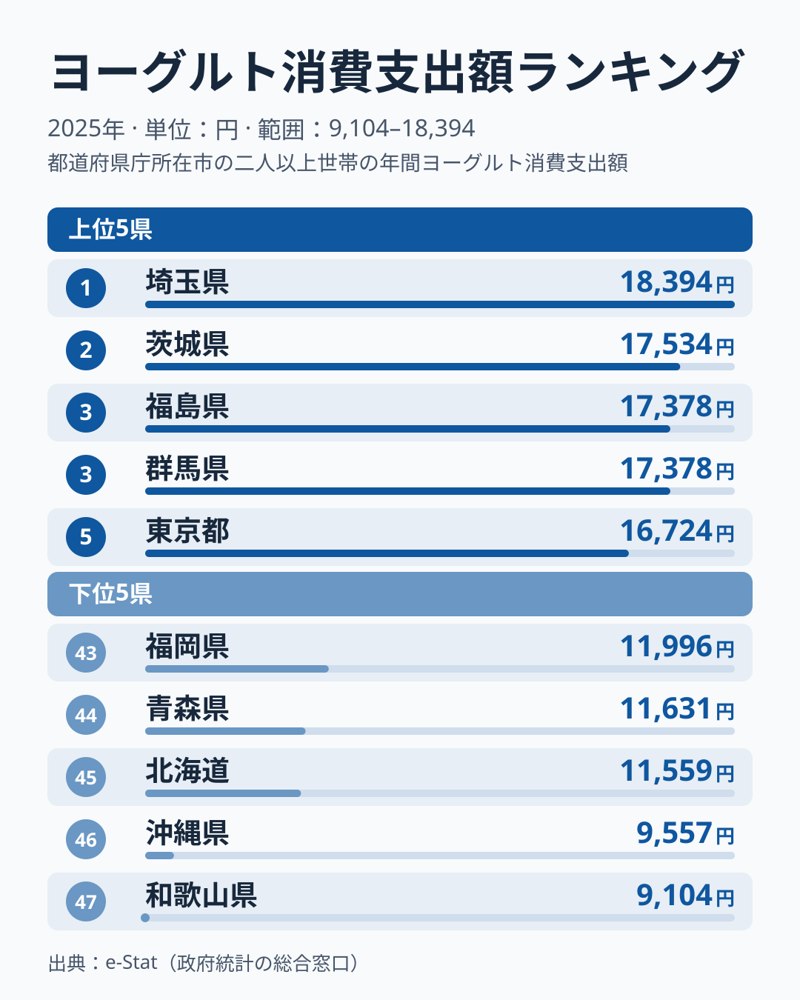

「同じヨーグルトでも、住む県で年間支出が約2倍違う」——そんな差が2025年の家計調査には現れています。ヨーグルト消費支出額（都道府県庁所在市・二人以上世帯の年間支出金額）のランキングを見ると、首位は[埼玉県](https://stats47.jp/areas/11000)の18,394円です。これに対して最下位の[和歌山県](https://stats47.jp/areas/30000)は9,104円で、その差は9,290円、倍率にして約2.02倍に達します。

意外なのは、前年の2024年に19,239円で首位だった山形県が2025年は11位の15,743円まで下がり、「東北が突出して多い」という見方が成り立たなくなった点です（2024年の値は同じランキングの年次データによります）。上位10県を見ると、埼玉・茨城・群馬・東京・神奈川・千葉の6都県が関東で、残りは福島・宮城（東北）、島根、富山です。下位には和歌山・沖縄に加えて、北海道・青森という北の県も入ります。「北で多く南で少ない」という単純な構図ではなく、関東への集中が目立つ結果です。この記事では、その偏りがどこまで鮮明かを[経済・家計カテゴリ](https://stats47.jp/category/economy)のデータとともに読み解きます。

> [!NOTE]
> 本データは総務省「家計調査」をもとにした、二人以上の世帯における都道府県庁所在市の1世帯あたりヨーグルト年間消費支出金額（円、2025年）です。県庁所在市の数値であり、県全体の平均とは厳密には一致しない点にご注意ください。

## ヨーグルト支出 上位・下位の全体像

首位の[埼玉県](https://stats47.jp/areas/11000)は18,394円で、2位の茨城県は17,534円です。続く3位は福島県と群馬県が17,378円で並び（同率）、5位が東京都で16,724円です。6位には島根県が16,603円で食い込み、7位は宮城県の16,350円、8位は富山県の16,329円、9位は神奈川県の16,174円、10位は千葉県の15,783円と続きます。千葉県の15,783円と11位の山形県の15,743円とでは差が40円しかなく、上位10県の境目はほとんど連続しています。上位は「関東を中心に、東北南部と北陸・山陰が混じる」顔ぶれです。

最下位は[和歌山県](https://stats47.jp/areas/30000)の9,104円です。1万円を下回るのは、この県と、46位で9,557円の沖縄の2県だけです。45位の北海道は11,559円、44位の青森県は11,631円、43位の福岡県は11,996円と続き、下位5県は紀伊半島・沖縄・北海道・青森・福岡と地理的にばらばらです。

上位と下位の差を数字で確認すると、1位の埼玉は18,394円、47位の和歌山は9,104円で、開きは9,290円です。年間ベースでこれだけ差があると、月に換算して約774円の違いになります。和歌山の水準は埼玉の約49%にとどまります。

<source-link href="/ranking/yogurt-consumption-expenditure">ヨーグルト消費支出額ランキングの全順位を見る</source-link>

## 下位グループは地方がばらばら

突出して低いのは、9,104円の和歌山県と9,557円の沖縄県の2県です。45位の北海道は11,559円で、沖縄との間には約2,000円の段差があります。そこから先は44位の青森県11,631円、43位の福岡県11,996円と連続しており、残りの下位は大差なく並んでいます。

一方、宮崎県は2024年に47位（9,113円）でしたが、2025年は30位の13,503円と中位まで上がりました。熊本県は39位で12,745円、大分県は42位で12,114円、鹿児島県は41位で12,191円と、九州の県は中位から下位に広く散らばっています。九州全体が低いとも、高いとも言えない結果です。

> [!TIP]
> 上位・下位を並べて見ると、「東北が多く九州が少ない」という地方単位の読み方は2025年のデータでは成り立ちません。関東が上位に集まる一方、東北でも宮城7位・山形11位・岩手15位・秋田24位・青森44位と順位が大きく割れています。地方でひとまとめにせず、県ごとの順位を確認するのが正確です。

## 関東の集中はどこまで言えるのか

上位10県のうち、関東は埼玉・茨城・群馬・東京・神奈川・千葉の6都県です。ただし関東全体が高いわけではなく、栃木県は18位の14,876円で、47県の単純平均である約14,284円の近くにとどまります。大都市圏に目を移しても、愛知県は21位で14,806円、大阪府は28位で13,785円、京都府は31位で13,477円と中位です。「都市部で買いやすいから多い」といった店舗環境の説明では、この中位の大都市圏を説明できません。上位には島根県が6位で16,603円、富山県が8位で16,329円と、関東の外の県も入っており、地理だけで上位が決まっているわけでもありません。

> [!WARNING]
> 家計調査は県庁所在市の標本調査で、1年の順位は標本のぶれの影響を強く受けます。同じランキングの年次データでは、首位は2022年が山形、2023年が茨城、2024年が山形、2025年が埼玉と毎年入れ替わっています。支出額は購入量と価格の両方を含むため、1年の順位だけで「◯◯県はヨーグルト好き」と断定することはできません。

首位が毎年入れ替わる以上、「関東が構造的に多い」と読むのは早計です。確実に言えるのは、2025年に関東の6都県が10位以内に入ったことと、首位から最下位まで約2.02倍の開きがあることまでです。なぜ関東に集まったのか、島根や富山が上位に来たのかについて、このデータだけから説明できる要因はありません。[ランキングの年次データ](/ranking/yogurt-consumption-expenditure)で複数年の推移を見て、同じ県が繰り返し上位に入るかを確かめて初めて「構造」と呼べます。

## まとめ

- ヨーグルト消費支出額の1位は**埼玉の18,394円**（2025年、二人以上世帯・県庁所在市）。
- 最下位は**和歌山の9,104円**で、首位との差は9,290円、**約2.0倍の開き**。
- 上位は**埼玉・茨城・福島/群馬（同率）・東京**と、**関東を中心**に10位以内の6都県を占めます。
- 下位は**和歌山・沖縄・北海道・青森・福岡**と地理的にばらばらで、特定の地方に集中していません。
- 前年首位の山形が11位に下がったように、市別の単年の順位はぶれが大きく、関東の集中を構造と断定する根拠は2025年の1年分だけでは足りません。
