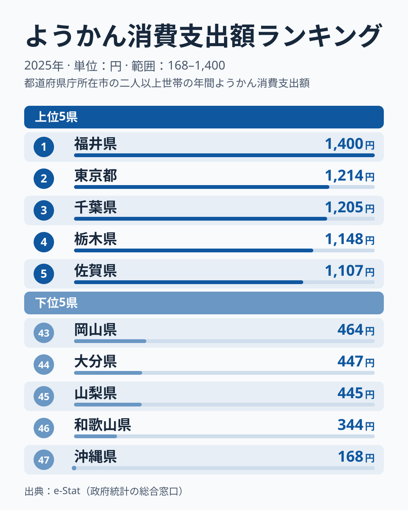
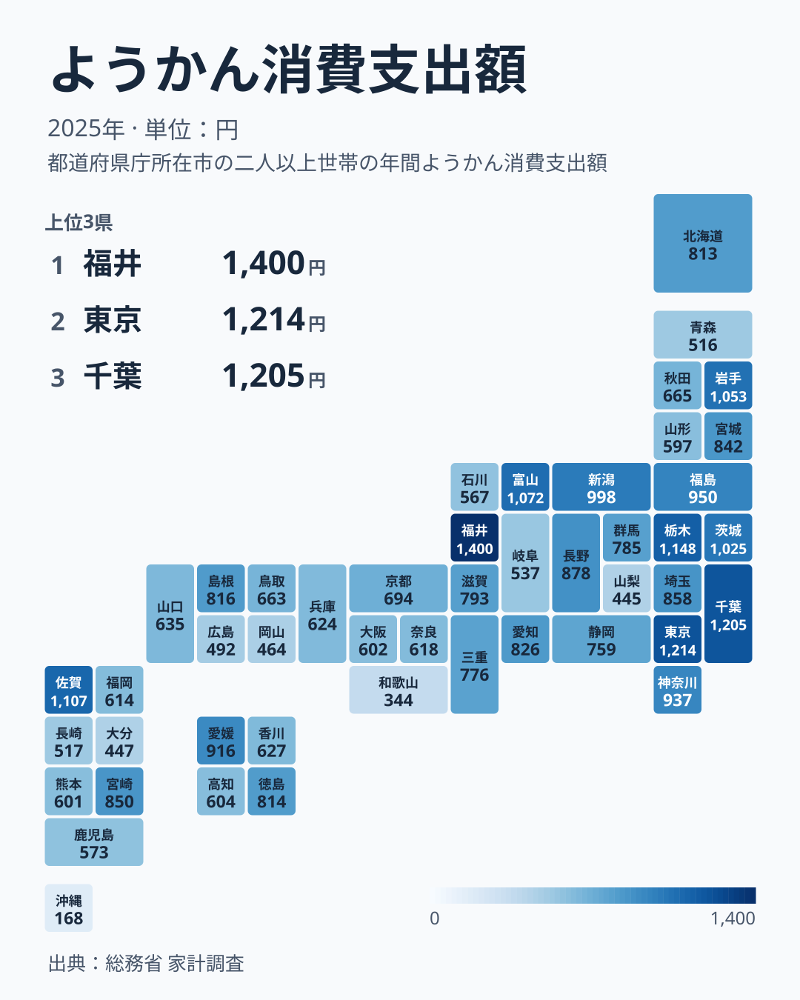

一世帯あたりのようかん（羊羹）の年間消費支出額には、都道府県で大きな差があります。総務省「家計調査」の2025年データによると、全国1位は福井県の1,400円、最下位は沖縄県の168円で、その差は8.3倍にのぼります。

ようかんは小豆と砂糖、寒天を練り上げた保存性の高い和菓子で、贈答品やお茶請けとして古くから親しまれてきました。今回のデータを見ると、単に「甘いものが好きな県」が上位に来ているわけではありません。上位10県は関東4県（東京・千葉・栃木・茨城）と北陸3県（福井・富山・新潟）が中心で、東北2県と九州の佐賀県が加わります。一方、近畿と中国の多くは中位より下に並びます。この記事では、その分布の背景を探ります。

> [!NOTE]
> 本データは総務省「家計調査」の品目別支出額（二人以上の世帯、年間換算）です。ようかんは調査上「他の和生菓子」等とは別区分で集計されており、単価の高い贈答用商品の購入も含まれます。世帯人数や購入頻度の違いが支出額に影響するため、消費「量」ではなく支出「額」の指標である点に注意してください。

## 上位と下位

<source-link href="/ranking/yokan-consumption-expenditure">ようかん消費支出額ランキングをもっと見る</source-link>

上位5県は福井県1,400円、東京都1,214円、千葉県1,205円、栃木県1,148円、佐賀県1,107円です。1位の福井県は2位の東京都を186円上回りますが、2位から5位までは1,214円から1,107円の間に4県が並んでおり、1位以外に大きな開きはありません。

上位に入った県の顔ぶれは、地域の幅が広い点が特徴です。東京都・千葉県・栃木県に加え、茨城県は8位で1,025円、神奈川県は11位で937円、埼玉県は14位で858円と、いずれも上位から中位上位にあり、関東は広く高めです。人口の多い都市圏では、贈答用や来客用の需要が支出を下支えしている可能性があります。[仮説] ただし栃木県が神奈川県や埼玉県より上位に来ていることは、都市規模だけでは説明できず、県庁所在市の標本世帯の購入行動が単年で強く出た可能性も残ります。

北陸では福井県が首位、富山県が6位（1,072円）、新潟県が9位（998円）と上位に並ぶ一方、石川県は38位（567円）にとどまります。「北陸だから和菓子が盛ん」と一括りにはできず、同じ北陸でも県ごとに水準が大きく異なることが分かります。[仮説] 福井県の首位は、法事や来客の手土産に日持ちする和菓子を備える習慣の影響が考えられますが、家計調査の数値だけでは確かめられないため、他の和菓子の支出や購入頻度のデータとの突き合わせが必要です。内陸では長野県が13位（878円）、山形県が36位（597円）と、同じ寒冷な内陸県でも位置が大きく分かれています。

> [!WARNING]
> 家計調査は都道府県庁所在市および政令指定都市の家計を中心にサンプリングされており、県内の地域差までは反映されません。ようかんのように年間の購入回数が少ない品目では、標本世帯の少しの違いで単年の順位が動きやすくなります。「福井県が1位」というのは県全体の平均的な傾向ではなく、その年の標本の結果である点に留意してください。

## 最下位グループの構造

下位5県は、沖縄県168円、和歌山県344円、山梨県445円、大分県447円、岡山県464円です。最下位の沖縄県は1位の福井県の約12％にとどまり、46位の和歌山県が344円で、そことも半分近い開きがあります。

沖縄県が最下位となっているのは、地理的にようかんの主要な産地から距離があることに加え、沖縄には黒糖菓子や紅芋タルトなど独自の菓子文化が根づいており、そちらの需要がようかんの代わりを担っている可能性があります。[仮説] ただし、同じく島嶼部の消費を持つ県との比較や、他の菓子類の支出との突き合わせは行っておらず、あくまで仮説です。

和歌山県から、42位で492円の広島県、43位で464円の岡山県までの下位グループには、近畿・中国の県が目立ちます。近畿では滋賀県が21位（793円）で最も高く、京都府25位（694円）、兵庫県30位（624円）、奈良県31位（618円）、大阪府34位（602円）、和歌山県46位と、残る府県はいずれも21位以下です。大阪府や京都府のように和菓子の老舗が多い地域でも支出額が高くならないことは、銘菓の産地であることと、家庭でのようかんの購入額が必ずしも結びつかないことを示しています。

九州は一括りにできません。佐賀県は5位（1,107円）、宮崎県は15位（850円）と上位に入る一方、福岡県32位（614円）、熊本県35位（601円）、鹿児島県37位（573円）、長崎県40位（517円）、大分県44位（447円）と下位寄りの県が多く、同じ地方の中で順位が大きく分かれています。[沖縄県の地域データ](/areas/47000)では、他の指標でも本州と異なる特徴が見られます。

## 発見：上位は関東と北陸、下位は近畿・中国に寄る

47都道府県マップで支出額の分布を見ると、単純な東西格差ではなく、より複雑な地域構造が浮かび上がります。

地図で濃い色（支出額が高い）に塗られているのは、福井・東京・千葉・栃木・佐賀・富山・岩手・茨城・新潟・福島の上位10県です。関東4県と北陸3県がまとまって濃く、東北では岩手・福島が入り、九州では佐賀だけが飛び地のように濃くなっています。上位10県のうち9県は本州の東半分（関東・北陸・東北）に集中していますが、佐賀県のような飛び地もあり、地域の文化だけでは説明しきれないばらつきも残ります。[福井県の地域データ](/areas/18000)でも、他の指標を併せて確認できます。

対照的に薄い色（支出額が低い）の地域は、沖縄、和歌山、山梨、大分、岡山の下位5県のほか、広島、青森、長崎などに散らばっています。北海道は20位（813円）で中位にあり、東北でも青森県は41位（516円）、秋田県は26位（665円）と、東北の中でも水準は分かれます。[仮説] この分布は各地域の代表的な和菓子や贈答習慣の違いを反映している可能性がありますが、家計調査の市別の値は標本が小さく単年のぶれも大きいため、構造として断定するには複数年の推移や品目別の詳細データによる検証が必要です。

> [!TIP]
> ようかんのような贈答性の高い和菓子は、地域の「お茶請け文化」や冠婚葬祭の慣習と結びついています。他の和菓子・洋菓子の消費支出ランキングと比較すると、その県がどのような菓子文化を持つかがより立体的に見えてきます。

## まとめ

- **全国1位**は福井県で年間1,400円、**最下位**は沖縄県で168円、その差は**8.3倍**
- 上位5県は福井・東京・千葉・栃木・佐賀で、上位10県は**関東4県・北陸3県**が中心
- 下位5県は沖縄・和歌山・山梨・大分・岡山で、**近畿・中国**の県が下位に目立つ
- 同じ北陸でも福井1位・石川38位、同じ九州でも佐賀5位・大分44位と、**地方内でも県ごとに差が大きい**
- 支出額の地理分布は、各地域の菓子文化や贈答習慣を反映している可能性があるが、単年のぶれもあり[仮説]の段階にとどまる

他の食品・家計消費の地域差については[家計調査カテゴリ](/category/economy)で一覧できます。

## データについて

総務省統計局「家計調査」（二人以上の世帯）品目別支出額データ（2025年）をもとに、e-Stat（政府統計の総合窓口）経由で集計しました。
